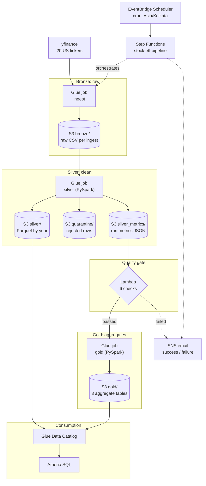
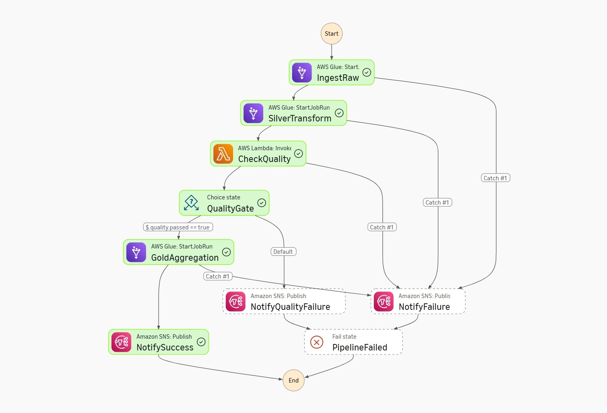
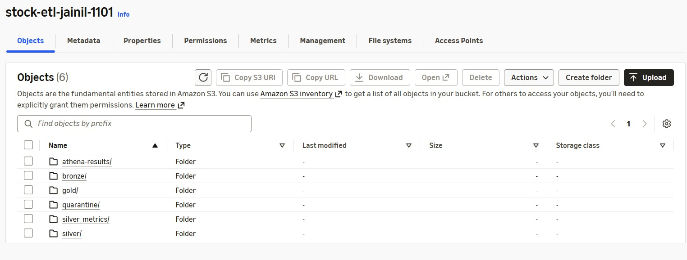
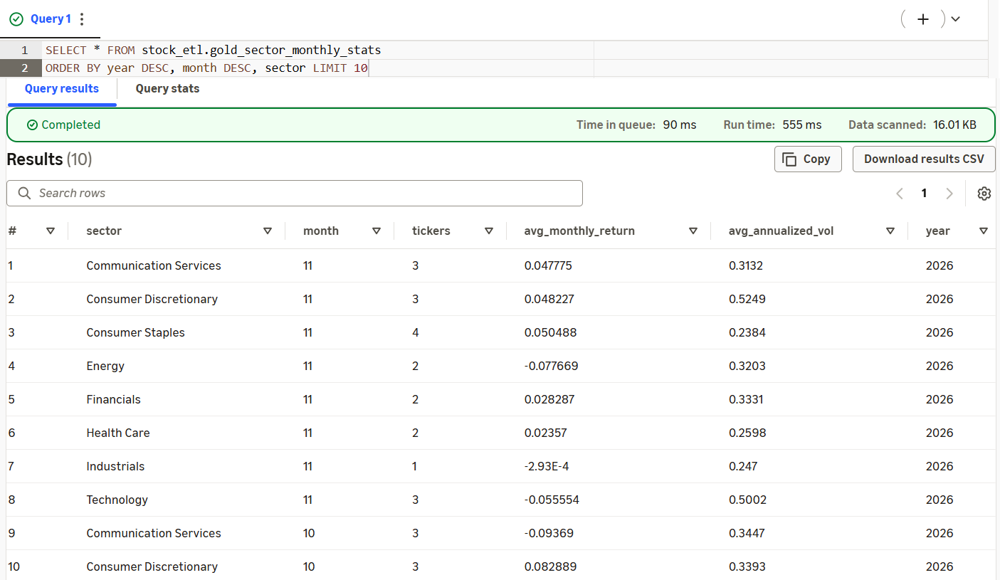
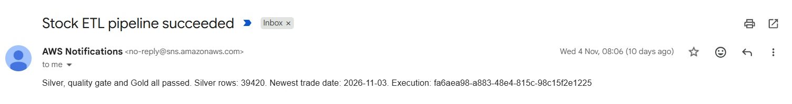
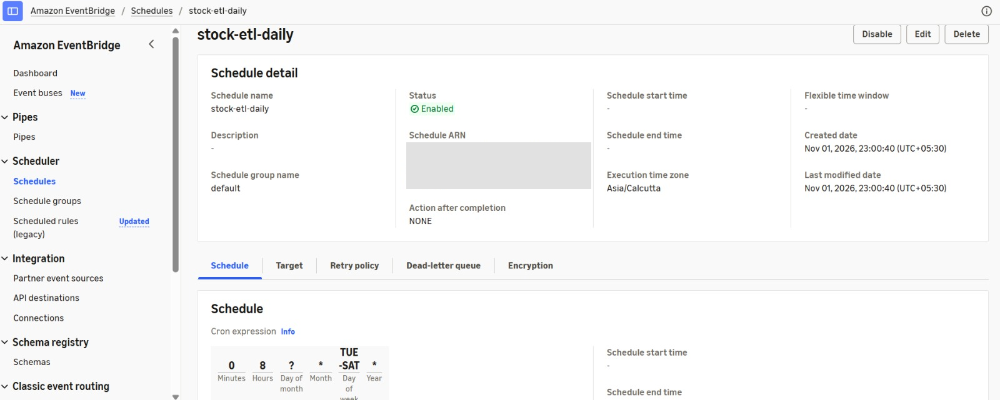

# Stock Market ETL Pipeline

A serverless data pipeline on AWS. It ingests daily prices for 20 US stocks, builds a **Bronze / Silver / Gold** data lake on S3 with **PySpark on AWS Glue**, runs a **data quality gate (Lambda)** before publishing aggregates, and exposes everything to SQL through **Athena**. **Step Functions** orchestrates the run and **EventBridge Scheduler** triggers it.

The project started as a local PySpark + PostgreSQL pipeline. That version is still in [`local_postgres/`](local_postgres/).

## Architecture



## Screenshots

**Orchestration: a successful Step Functions run (failure paths shown dashed)**



**Medallion layout in S3**



**Gold layer queried in Athena**



**Quality-gate success notification**



**Scheduled daily run (EventBridge Scheduler)**



## Pipeline stages

| Stage | AWS service | Code | Output |
|---|---|---|---|
| Ingest | Glue job | [`aws/glue/ingest_job.py`](aws/glue/ingest_job.py) | `bronze/stocks/ingest_date=YYYY-MM-DD/raw_stock_data_incremental.csv` (last 10 days by default) |
| Silver | Glue job (PySpark) | [`aws/glue/silver_job.py`](aws/glue/silver_job.py) | `silver/stocks/` (Parquet, partitioned by year), `quarantine/stocks/` (rejected rows), `silver_metrics/stocks/` (run metrics JSON) |
| Quality gate | Lambda | [`aws/lambda/quality_gate.py`](aws/lambda/quality_gate.py) | `passed` or `failed` with the list of failed checks |
| Gold | Glue job (PySpark) | [`aws/glue/gold_job.py`](aws/glue/gold_job.py) | `gold/ticker_summary/`, `gold/monthly_ticker_stats/`, `gold/sector_monthly_stats/` |
| Orchestration | Step Functions | [`aws/stepfunctions/pipeline.asl.json`](aws/stepfunctions/pipeline.asl.json) | Ingest, Silver, gate, Gold, then an SNS email. Any failure sends an SNS email and ends the execution as failed. |
| Schedule | EventBridge Scheduler | n/a | `cron(0 8 ? * TUE-SAT *)` in Asia/Kolkata, after the US market close |
| Query | Athena + Glue Data Catalog | [`aws/athena/`](aws/athena/) | Tables `stock_etl.silver_stocks` and `stock_etl.gold_*` |

## Data model

**Silver** (`stock_etl.silver_stocks`): `ticker`, `trade_date`, `open`, `high`, `low`, `close`, `volume`, `moving_avg_7d`, `daily_return`, `ingest_date`, partitioned by `year`.

- `moving_avg_7d` is empty until a full 7-trading-day window exists, instead of averaging a partial window.
- `daily_return` is $(P_t - P_{t-1}) / P_{t-1}$.
- Rows are rejected into quarantine with one of these reasons: `null_or_unparseable_date`, `null_ticker`, `null_close`, `non_positive_close`, `high_below_low`, `negative_volume`.

**Gold** tables:

| Table | Grain | Main columns |
|---|---|---|
| `gold_ticker_summary` | one row per ticker | total return, annualized volatility, max drawdown, average volume, best and worst day |
| `gold_monthly_ticker_stats` | ticker x month | monthly return, month-end close, total volume, annualized volatility |
| `gold_sector_monthly_stats` | sector x month | equal-weighted average monthly return and volatility |

Formulas used in Gold:

$$\sigma_{\text{ann}} = \sigma_{\text{daily}} \sqrt{252}$$

$$r_{\text{month}} = \prod_{d \in \text{month}} (1 + r_d) - 1$$

$$\text{max drawdown} = \min_t \left( \frac{P_t}{\max_{s \le t} P_s} - 1 \right)$$

The ticker-to-sector mapping is a small dictionary at the top of `gold_job.py`. A ticker that is missing from it shows up as `Unknown`, so a missing mapping is visible instead of silent.

## Data quality gate

The Silver job writes one small metrics file. The Lambda reads it and fails the run if any check fails, so Gold is never rebuilt from bad data. Thresholds are Lambda environment variables.

| Check | Default |
|---|---|
| Silver output is not empty | n/a |
| Reject rate of raw rows | at most 1% (`MAX_REJECT_PCT`) |
| No duplicate (ticker, trade_date) rows | n/a |
| Number of distinct tickers | at least 20 (`MIN_TICKERS`) |
| Newest trade date is recent | at most 5 days old (`MAX_STALENESS_DAYS`) |
| Row count did not shrink versus the previous run | at most 1% drop (`MAX_SHRINK_PCT`) |

The shrink check exists because of a real incident during development. An incremental ingest wrote to the same S3 key as the full-history file and overwrote it. Silver was then rebuilt from 140 rows instead of 39,380, and every other check still passed. The ingest job now writes to its own file name, and the gate compares each run with the previous one. Both fixes have regression tests.

## Design decisions and trade-offs

- **Bronze is raw and append-only.** Each ingest lands in its own `ingest_date=` folder under its own file name. The full history is loaded once with `fetch_data.py`. After that the Glue ingest job pulls a 10-day window, and the overlap is resolved in Silver.
- **Newest ingest wins.** Silver de-duplicates on (ticker, trade_date) and keeps the row from the most recent ingest. If two files share an ingest date, the file name breaks the tie, so the result is deterministic.
- **Silver is recomputed from all of Bronze on every run and overwritten.** That makes every run idempotent and lets the window functions see the full history. At this size (about 39K rows) it is cheap. At larger scale this would become incremental partition processing or an open table format.
- **Quarantine instead of dropping.** Rejected rows are kept with a reason, so bad data can be inspected.
- **No Glue crawler.** Tables are defined with DDL and Athena partition projection, so there is no crawler cost and no `MSCK REPAIR TABLE`.
- **The gate reads a metrics file, not the data**, so it stays fast and cheap.
- **Prices use `auto_adjust=True`.** Historical prices can shift slightly after splits or dividends, so a full reload (`python fetch_data.py`, then a pipeline run) is worth doing occasionally.
- **Spark is more than this data needs.** It was chosen deliberately to use the same patterns that scale.

**Known limitation:** Silver is overwritten before the gate runs, so a bad run can damage Silver (Gold is protected). Recovery means fixing Bronze and re-running. A production design would write Silver to a staging prefix and promote it only after the gate passes.

## Deploy on AWS (console walkthrough)

All resources live in one region (this project used `ap-southeast-2`). Replace the bucket name `stock-etl-jainil-1101` in the SQL files and the Step Functions definition with your own.

1. **S3 bucket.** Create a general-purpose bucket with Block Public Access on. Prefixes appear on their own when files are first written.
2. **IAM.**
   - Create the policy from [`aws/iam/s3-access-policy.json`](aws/iam/s3-access-policy.json) after replacing `YOUR_BUCKET_NAME`.
   - Create a role trusted by Glue with `AWSGlueServiceRole` and that policy, named `stock-etl-glue-role`.
   - Create an IAM user for the CLI with the same S3 policy, then run `aws configure`.
3. **Initial full load.** Copy `.env.sample` to `.env`, set `BUCKET_NAME` and `AWS_REGION`, then run `python fetch_data.py`.
4. **Glue jobs.** Create three Script editor jobs (Spark) with role `stock-etl-glue-role`, G.1X workers, 2 workers, a 10-minute timeout, 0 retries and job bookmarks disabled. Job parameters:

   | Job | Script | Parameters |
   |---|---|---|
   | `stock-ingest-job` | `ingest_job.py` | `--additional-python-modules yfinance`, `--bucket <bucket>` |
   | `stock-silver-job` | `silver_job.py` | `--bronze_path s3://<bucket>/bronze/stocks/`, `--silver_path s3://<bucket>/silver/stocks/`, `--quarantine_path s3://<bucket>/quarantine/stocks/`, `--metrics_path s3://<bucket>/silver_metrics/stocks/` |
   | `stock-gold-job` | `gold_job.py` | `--silver_path s3://<bucket>/silver/stocks/`, `--gold_path s3://<bucket>/gold/` |

5. **Athena.** Set the query result location to `s3://<bucket>/athena-results/`, then run [`silver_table.sql`](aws/athena/silver_table.sql) and [`gold_tables.sql`](aws/athena/gold_tables.sql), one statement at a time.
6. **Lambda.** Create a Python function named `stock-quality-gate` with the code from `quality_gate.py` and a 15-second timeout. Give its role the policy in [`aws/iam/quality-gate-lambda-policy.json`](aws/iam/quality-gate-lambda-policy.json).
7. **SNS.** Create a standard topic, subscribe your email and confirm the subscription.
8. **Step Functions.** Create a state machine from [`pipeline.asl.json`](aws/stepfunctions/pipeline.asl.json). Replace `REPLACE_WITH_LAMBDA_ARN` and `REPLACE_WITH_YOUR_SNS_TOPIC_ARN` (three places), and check the bucket name in the `CheckQuality` payload. Let the console create the execution role.
9. **EventBridge Scheduler.** Add a schedule with a Step Functions `StartExecution` target and the cron expression from the table above.

## Run the original local version (PostgreSQL)

Requires Java, PostgreSQL and a `.env` with the `DB_*` values. Run all commands from the repository root.

```bash
pip install -r requirements.txt
psql -U postgres -d stock_etl -f local_postgres/schema.sql
python fetch_data.py --local                 # writes data/raw_stock_data.csv
python local_postgres/ingest_validate.py     # schema, null and duplicate checks
python local_postgres/transform.py           # windowed metrics -> data/transformed_stock_data.csv
python local_postgres/load.py                # idempotent upsert into the star schema
```

`local_postgres/test_setup.py` checks the Spark and PostgreSQL connections.

## Tests

```bash
pip install -r requirements-dev.txt
pytest                      # whole suite, about a minute
pytest -m "not spark"       # fast subset without Spark
```

| File | Covers |
|---|---|
| `tests/test_quality_gate.py` | every gate check, including the shrink regression and the metrics loader |
| `tests/test_ingest_job.py` | S3 key layout, never overwriting the full-history file, lookback window, failure on a missing ticker |
| `tests/test_silver_job.py` | quarantine reasons, de-duplication, window metrics, run metrics, idempotent re-runs (runs the real script on local Spark) |
| `tests/test_gold_job.py` | return, drawdown and volatility against pandas, monthly returns, sector mapping |

The Spark tests need Java. On Windows they are skipped unless `HADOOP_HOME` points to a winutils install, so run them on Linux or WSL.

## Repository layout

```
.
|-- aws/
|   |-- glue/            ingest_job.py, silver_job.py, gold_job.py
|   |-- lambda/          quality_gate.py
|   |-- stepfunctions/   pipeline.asl.json
|   |-- athena/          silver_table.sql, gold_tables.sql
|   `-- iam/             S3 policy for Glue and the CLI user, S3 read policy for the Lambda
|-- local_postgres/      original local pipeline and schema.sql
|-- tests/               pytest suite
|-- docs/                architecture.png
|-- fetch_data.py        full-history load into Bronze (or a local CSV with --local)
|-- requirements.txt, requirements-dev.txt, pytest.ini
`-- .env.sample
```

## Future work

- Infrastructure as code (CloudFormation or Terraform) instead of console steps.
- CI that runs the tests on every push.
- Staging prefix for Silver, promoted only after the gate passes.
- An open table format such as Iceberg for incremental Silver updates.

## Author

Jainil Patel - [GitHub](https://github.com/Jainil-Patel1210) · [LinkedIn](https://www.linkedin.com/in/jainil-patel-513790343/)
